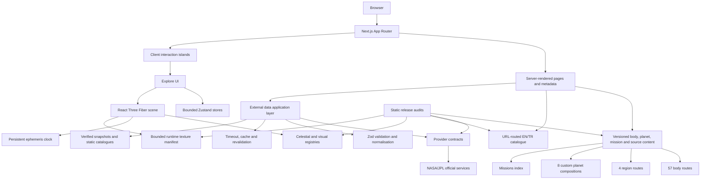

# Helios Architecture

## System diagram

### Ownership summary

- Server pages own metadata, locale resolution and external-data loading.
- Provider adapters own URL construction, timeout, validation, normalisation and fallback selection.
- Client stores own bounded interaction state, never reference scientific truth.
- `CameraRig` and the persistent ephemeris controller are the scene authorities.
- Lightweight route registries feed sitemap/navigation without importing full editorial models.
- Runtime assets enter the release only through the manifest and provenance audits.

## Runtime contract

Helios uses Next.js App Router, strict TypeScript, React Three Fiber/Three.js, Zustand, Zod, Vitest and Playwright. Server code owns external retrieval, validation, cache and fallback selection. Client stores contain bounded interaction state, never duplicated scientific truth.

## Routes and content

- `/body/[slug]` is canonical for 57 real bodies.
- `/region/[slug]` owns four non-body context layers.
- `/planet/[slug]` and `/object/[slug]` remain compatibility routes and publish the matching body canonical.
- Eight planets retain custom editorial compositions; the remaining objects use the shared body-detail renderer. Both systems reuse the local, attributed runtime texture catalogue for editorial portraits instead of duplicating image assets.
- A lightweight route registry feeds sitemap/navigation without importing full editorial models.
- `/missions` derives sourced records from the planet content catalogue.

## Server/client boundary

Server Components own:

- request locale and metadata;
- versioned reference/editorial content;
- external-provider calls;
- validation, cache policy and fallback selection;
- source/provenance resolution.

Client islands own:

- WebGL scene and camera interaction;
- bounded Explore, ephemeris, galactic-context and locale stores;
- forms and share-link interaction;
- progressive media controls.

`"use client"` is kept below route entrypoints wherever possible.

## Explore ownership

- The persistent ephemeris controller owns timestamp, speed, pause/resume, reset and provider scheduling.
- `CameraRig` owns guided/free/transition/focus camera behavior. A guided transition is not initialised until the selected scene target and its focus metadata are registered; controls remain usable while that registration completes. Scale-profile changes deliberately recalculate canonical framing rather than preserving the prior profile distance. Transition completion uses target-scaled position/aim tolerances and snaps to the exact requested pose, so physically tiny Scientific targets cannot settle while they are still visually distant.
- Celestial registries own body identity, source orbit data, representation and visual policy.
- Frame loops mutate Three.js objects directly and publish React state only on meaningful phase/state boundaries.
- Galactic Context is a separate schematic representation, lazily allocated at the transition threshold.

## External data

`provider-contracts.ts` is the single registry for auth, official endpoint, timeout, revalidation, expected version and fallback. Provider adapters:

1. construct allowlisted requests;
2. enforce timeout and cache tags;
3. validate raw responses with Zod;
4. reject malformed or changed-version payloads;
5. normalise source, observation and retrieval metadata;
6. select verified snapshot/static fallback or unavailable state.

InSight is historical-only and cannot create a runtime network request.

## Language

Each locale has its own URL space: English is unprefixed and Turkish lives under `/tr`. Pages live in `src/app/[locale]/` and are prerendered for both locales; `src/proxy.ts` rewrites unprefixed URLs onto the English segment and redirects visitors with a saved Turkish preference. The locale param seeds the client locale store, and `@/components/localized-link` keeps internal links in the active locale. Both EN and TR cover the complete product surface. See `I18N.md` for canonical and `hreflang` rules.

## Performance and assets

- One High visual contract.
- Server-rendered pages use a low-cost CSS ambient backdrop and local attributed planet/body textures; these editorial layers do not import the WebGL scene graph. The ambient grid is offset from the viewport edge so it cannot produce a false top border. Texture drift is transform-based to avoid continuous background-position repaint, Saturn uses a CSS elliptical band treatment rather than stretching the scene ring strip into a page image, and the Home system diagram uses SVG ellipses with markers geometrically bound to their paths.
- DPR capped at 1.75.
- Runtime textures are manifest-owned, hashed, source-attributed and resolution-bounded.
- Home and Missions are guarded from WebGL dependency leakage.
- Static budgets are checked by `audit:budgets`; native runtime metrics require a production browser run.

See `CELESTIAL_MODEL.md`, `ASSET_AND_SOURCES.md`, `API_ACCEPTANCE.md`, `I18N.md` and `PERFORMANCE.md`.
